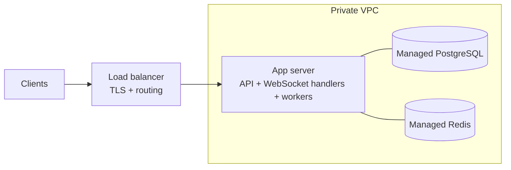
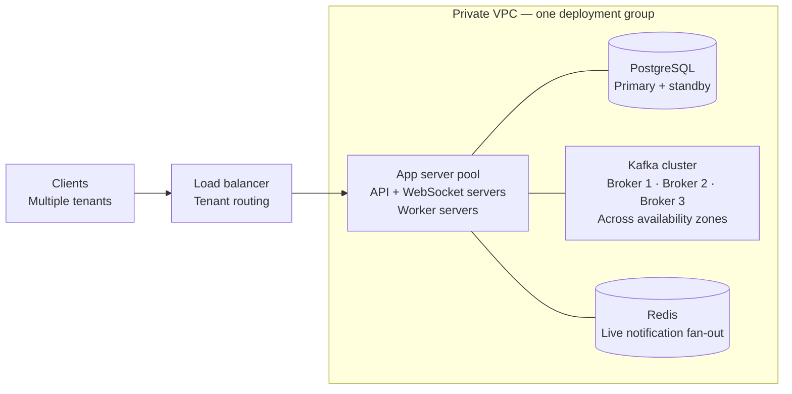
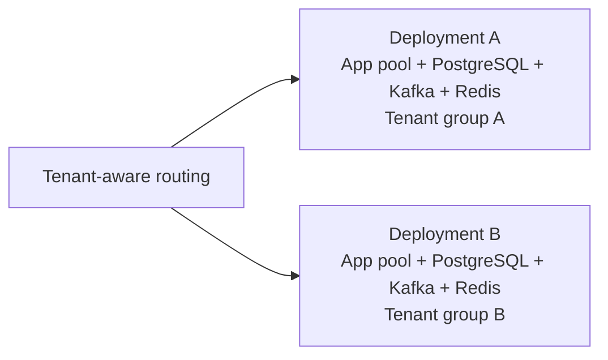

# Document Redlining: Production Strategy

**Author: Sai Naidu**

Production proposals and tradeoffs for Part II. Authentication, RBAC, tenant
isolation, deployment automation, and monitoring below are future work; the
current v0 behavior is documented in the [README](README.md).

## Architecture and Infra

- **Redis first.** Streams handles indexing and notification events; Pub/Sub wakes connected clients. Our two current consumer groups favor simplicity. Pub/Sub isn't durable, so app servers reconcile database state and send clients fresh updates after missed notifications.
- **Kafka when justified.** Revisit it as throughput, retention, or replay needs grow. The outbox makes migration feasible, but ordering and recovery need revalidation. Redis avoids Kafka partition/rebalancing work, while still requiring persistence and replication configuration.
- **Durable concurrent writes.** Most implementation effort went into durability, performance, and deduplication. PostgreSQL locks make range-reservation checks atomic; queues absorb bursts but don't remove contention. Committed writes are transactional; search is eventually consistent.

## CI and Deployment

- **Fast pre-merge checks.** Run correctness tests and lightweight corpus benchmarks. Keep longer read/write load tests on controlled pre-release infrastructure: slower feedback, but more reliable measurements.
- **Search quality gates.** Let's make sure search is actually good. Track nDCG and recall alongside latency. Small evaluations can run in CI; larger ones belong before production. Evaluation isn't necessarily more expensive than load testing.

## Security and Compliance

- **Authenticated ownership.** Require authentication and RBAC on every request and subscription. Record the authenticated actor with each operation; client IDs aren't authentication.
- **Single-tenant preference.** Shared multitenancy needs isolation across ingress, storage, caches, and egress. I prefer single-tenant search deployments: simpler isolation, but higher fixed costs and slower fleet-wide incident remediation.
- **Private networking.** Keep data services in private VPC networking behind controlled ingress. This complements encryption and authorization; it doesn't replace them.

## Scalability and Resilience

- **Dedupe where needed.** Review mutating APIs for unsafe retries. Reservation-bound replacements and one-shot idempotency keys already cover our main writes. Tracing request IDs serve a separate purpose.
- **Scale event storage when needed.** Spreading Redis event data across servers requires multiple streams. Kafka provides partitioned topics; switch when event volume or retention justifies the extra infrastructure.
- **Noisy-neighbor isolation.** Dedicated deployments protect against bursty tenants. Dedicated Kafka clusters are an option, but add substantial fixed cost and maintenance.
- **Batch reindexing.** Coalesce rapid edits into the latest revision. A one-minute window could work if users accept that freshness delay. Index every changed document; optimizing only for common searches could miss future queries.
- **Document size and storage.** Plan indexing capacity and storage around document size and edit frequency, not just document count. V0 reindexes whole documents and stores full revisions; large, frequently edited contracts increase memory, indexing time, and storage. Chunked indexing and revision compaction could reduce those costs, but add offset and history-reconstruction complexity.

## Monitoring and Observability

- **Trace across stages.** Carry correlation IDs from API requests into background work.
- **Watch abnormal patterns.** Log unusual increases in duplicate writes or overlapping reservations. Individual duplicates and conflicts are expected, not automatically incidents.
- **Measure completion, not just acceptance.** Track p50/p90/p99 for admission, committed updates, corpus search, and document search; also queue age, indexing lag, and cache hit/miss ratio.
- **Keep alerts actionable.** Alert on availability and sustained latency thresholds. Less noise trades off against detection speed.

## Operations and Cost

- **Reduce repeated indexing.** Combine rapid updates to save compute, accepting bounded search staleness. Tune the interval to observed editing patterns and customer expectations.

## Releases and infrastructure

These show proposed infrastructure, not request lifecycles. Boxes represent server
pools or managed services. Lines show connectivity; replicas within a pool can run
on separate machines. WebSocket handlers and connection state live in the app
servers; the load balancer only routes their connections.

### V0 — one small deployment

- **Small start.** One app host runs separate API and worker processes. PostgreSQL stores documents and durable work; Redis handles event delivery and live notifications.
- **Availability tradeoff.** One app host is a failure point. Add a second behind the load balancer when availability requires it; configure database/Redis replicas and backups separately.

### Future — multiple tenants sharing scalable infrastructure

- **More compute.** Add API servers behind the load balancer and worker servers as processing demand grows. They can scale independently.
- **More event capacity.** Add Kafka brokers and redistribute partitions. More brokers provide capacity only when partitions and workload are distributed across them. Kafka controller infrastructure is omitted here.
- **Database limit.** A PostgreSQL standby provides failover, not additional write capacity. Split tenants across database deployments when one primary reaches its limits; writes to one document remain serialized.
- **Shared versus dedicated.** Multiple tenants can share this deployment with authorization, data isolation, and quotas. A large or sensitive tenant can get a dedicated copy, at higher cost.

### Beyond one cluster — repeat the deployment

- **Independent capacity.** Each deployment has its own Kafka cluster and database capacity. Routing assigns a tenant to one deployment; adding a cluster does not automatically spread existing tenants across it.
- **V0 to future.** Kafka replaces Redis Streams. PostgreSQL continues to own document writes, and Redis can remain for live notification fan-out. Multi-tenant routing and isolation are proposed additions, not implemented v0 features.
