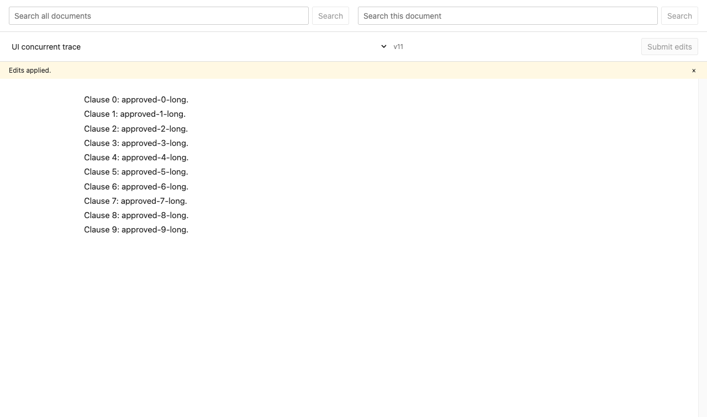

# Contract search and redlining benchmark

Run: 2026-10-12T20:44:58Z. Environment: macOS-26.6.2-arm64-arm-64bit-Mach-O; Python 3.13.6.

Corpus: 510 CUAD contracts, 26,820,468 UTF-8 bytes. SHA-256 `ed0b77d85bdf4014d7495800e8e4a70565b48ee6f8a2e5dca9cf8655dbf10eae`. No LLMs.

## Method and interpretation

[CUAD](https://www.atticusprojectai.org/cuad/) is a lawyer-annotated clause extraction dataset, not an official document-ranking benchmark. We derive 41 category queries from its labels; a document is relevant if that category has a nonempty annotated answer. Labels such as “Parties” are deliberately not rewritten to favor an engine. Missing annotations are treated as nonrelevant. These are diagnostic proxy judgments, not official CUAD or BEIR scores.

Both engines receive the same category words with AND semantics and the same unmodified 510 contracts. PostgreSQL returns occurrence hits in document-ID order; we deduplicate its first 100 hits into at most 10 documents. This cap can reduce recall. FTS5 directly returns 10 documents ordered by BM25. The comparison measures the current product behavior, including that mismatch.

Latency: one warm-up then 3 measured passes per query; sequential requests, nearest-rank p95. HTTP includes transport, source resolution and snippets; FTS5 is in-process, memory-resident SQL without HTTP/snippets. Their latency is NOT a controlled database speed comparison. Seed/index construction is excluded. PostgreSQL seed plus initial indexing: 4.95s; FTS5 build: 0.20s.

[BEIR](https://github.com/beir-cellar/beir) uses relevance metrics including nDCG and Recall; we use those metric definitions but do not compare scores across different datasets. [FTS5 BM25](https://www.sqlite.org/fts5.html#the_bm25_function) is the local classical retrieval baseline. This run is not evidence of production capacity or semantic search quality.

## Search results

| Engine | nDCG@10 | Recall@10 | MRR@10 | p50 ms | p95 ms | Samples |
|---|---:|---:|---:|---:|---:|---:|
| Current PostgreSQL API | 0.5897 | 0.0585 | 0.7455 | 247.57 | 656.40 | 123 |
| SQLite FTS5 BM25 baseline | 0.6237 | 0.0706 | 0.7156 | 0.53 | 1.77 | 123 |

Search assertions passed: 30 literal queries resolve to exact source slices, returned category-hit offsets/context are valid, and an absent query returns no hits. Full per-query rankings and scores are in `results.json`.

## API editing behavior

- same-client selection returns existing reservation
- overlapping client gets 409
- 10 disjoint replacements exactly once, eagerly shifted anchors
- replay returns original committed revision
- changed payload rejected 409
- stale reservation rejected 409

10 concurrent replacements: p50 2033.51ms, p95 2039.70ms, measured from HTTP submission through full response and revision validation. Three sequential reserve+replace requests on a 26,820,977-byte synthetic concatenation: p50 885.43ms, p95 887.58ms. Three samples are a smoke measurement, not a reliable tail estimate. Exact full text was verified each time.

Final large-document index observed current 6074.70ms after the response (HTTP observation upper bound, not exact indexing latency).

## Browser concurrency

Selenium drove 10 independent Chrome 154.0.8037.98 sessions. Each selected text, typed a replacement, waited for draft save, then clicked Submit at a shared barrier. All ten observed the exact final text at v11 through their UI subscriptions. Click-to-all-updates-observed p50 731.72ms, p95 735.42ms; this includes Selenium scheduling and wait overhead, not pure server latency.



## Small-document traces

Submission order below is the test-client timestamp immediately before POST/click, not server arrival order. Processing order is the committed revision number: v2 is first. No FIFO is promised or required for disjoint reserved ranges. Length-changing edits verify eager anchor movement.

### HTTP

| Submission rank | Client | Processing rank | Revision | Elapsed ms |
|---:|---:|---:|---:|---:|
| 1 | 7 | 9 | 10 | 2039.08 |
| 2 | 1 | 7 | 8 | 2035.62 |
| 3 | 0 | 6 | 7 | 2034.30 |
| 4 | 5 | 2 | 3 | 2029.63 |
| 5 | 3 | 5 | 6 | 2032.72 |
| 6 | 6 | 4 | 5 | 2031.44 |
| 7 | 2 | 1 | 2 | 2028.32 |
| 8 | 4 | 10 | 11 | 2039.70 |
| 9 | 8 | 3 | 4 | 2029.85 |
| 10 | 9 | 8 | 9 | 2036.23 |

### Selenium

| Submission rank | Client | Processing rank | Revision | Elapsed ms |
|---:|---:|---:|---:|---:|
| 1 | 2 | 2 | 3 | 732.17 |
| 2 | 4 | 1 | 2 | 719.74 |
| 3 | 9 | 4 | 5 | 731.80 |
| 4 | 3 | 10 | 11 | 734.58 |
| 5 | 0 | 5 | 6 | 719.30 |
| 6 | 6 | 7 | 8 | 735.42 |
| 7 | 5 | 9 | 10 | 729.54 |
| 8 | 7 | 3 | 4 | 729.29 |
| 9 | 8 | 6 | 7 | 731.64 |
| 10 | 1 | 8 | 9 | 732.22 |

Initial v1 (both suites):

```text
Clause 0: TOKEN0.
Clause 1: TOKEN1.
Clause 2: TOKEN2.
Clause 3: TOKEN3.
Clause 4: TOKEN4.
Clause 5: TOKEN5.
Clause 6: TOKEN6.
Clause 7: TOKEN7.
Clause 8: TOKEN8.
Clause 9: TOKEN9.
```

Final v11 (both suites):

```text
Clause 0: approved-0-long.
Clause 1: approved-1-long.
Clause 2: approved-2-long.
Clause 3: approved-3-long.
Clause 4: approved-4-long.
Clause 5: approved-5-long.
Clause 6: approved-6-long.
Clause 7: approved-7-long.
Clause 8: approved-8-long.
Clause 9: approved-9-long.
```

## Limits and next decisions

The current API has no relevance scoring. The baseline exposes whether adding ranking helps these queries; neither keyword system understands clause meaning. This run tests one host, 10 clients, one worker, warm reads and 510 contracts. Workers start after search measurement, with corpus creation events still in the outbox; edit timings therefore include startup/backlog effects and may include the server’s two-second outcome-reconciliation fallback. The browser suite runs later after that backlog has had time to drain. These are different operating conditions, not evidence that browser writes are faster than HTTP writes. It does not measure crash recovery, lease expiry timing, multi-host capacity, sustained load, or cold-cache behavior; existing unit/integration tests cover additional failure paths. A single large synthetic document validates large payload handling, not near-linear scaling across sizes.

Reproduce with `python -m benchmarks.run`; see `benchmarks/README.md`. The harness uses an isolated PostgreSQL schema and temporary Redis, records failures as `failure.json`, and drops its own schema/services on exit. Corpus attribution: The Atticus Project; Hendrycks, Burns, Chen and Ball (2021), CC BY 4.0.
